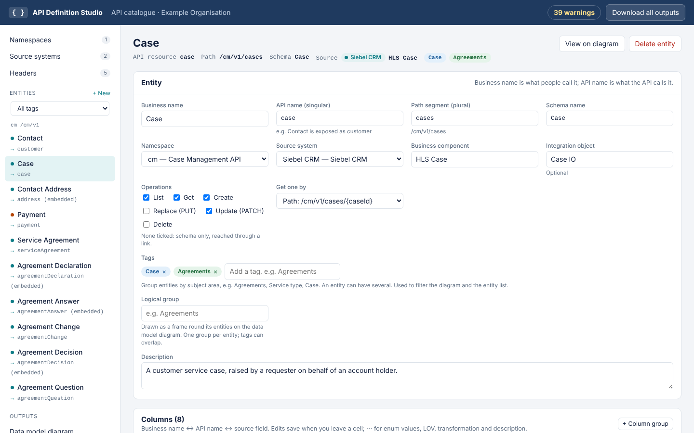
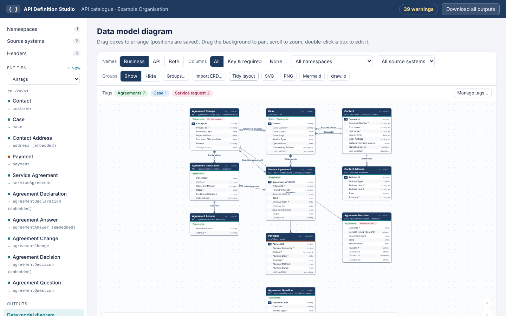

# API Definition Studio

Design API resources over entities held in your source systems (Siebel CRM,
other services, databases, files, mainframe) and generate, from one model:

- an **OpenAPI 3.0.3 definition** per namespace (YAML and JSON),
- an **Excel mapping sheet** (business name ↔ API name ↔ source field), which
  you can edit in Excel and import back,
- a **data model diagram** with business names (in the app, plus SVG, PNG,
  Mermaid and draw.io downloads).

It starts with a small customer-service example: a Siebel **Contact** exposed
in the API as **`customer`**, a **Case** linked to it twice (account holder and
requester), a **Contact Address** embedded inside the customer, and a
**Payment** from a separate REST payments service, linked to the Case.

Nothing in the studio is tied to one organisation or domain: the starter model,
the worked example and the test fixtures are illustrations. Replace them with
your own model, or start from an empty one.





## Run it

Needs Python 3.9 or later.

```bash
git clone https://github.com/joshualouis911/api-definition-studio.git
cd api-definition-studio
python3 -m venv .venv
source .venv/bin/activate          # Windows: .venv\Scripts\activate
pip install .
api-definition-studio              # http://127.0.0.1:8100/
```

Or straight from GitHub: `pip install git+https://github.com/joshualouis911/api-definition-studio.git`.

Options: `api-definition-studio run --port 8100 --host 127.0.0.1 --data ./studio-data`.
The model is saved as `studio-data/model.json` in the folder you start it from
(or `$ADS_DATA_DIR`).

## Concepts

| Concept | What it is | Example |
|---|---|---|
| **Source system** | An application data comes from, with a type that names its source fields | `siebel` (Siebel CRM), `payments` (REST / web API) |
| **Namespace** | One API definition: key, title, base path, version, security, servers | `cm`, `/cm/v1`, bearer token |
| **Entity** | A source object and the resource it becomes. Business name and API name are separate. Picks one source system, or none | Business name *Contact* → API name `customer`, path `/cm/v1/customers`, schema `Customer`, source Siebel BC *Contact* |
| **Column** | One field: business name, API name, DD attribute reference, type, flags, enum values, source mapping (optional), transformation, example | *First Name* → `firstName` ← BC field `First Name` / `S_CONTACT.FST_NAME`, DD `DD-PER-003` |
| **Linked entity** | A relationship with a cardinality, and how each end shows it in the API | Case many-to-one Contact, *Account holder* |

How a link can be exposed, at either end:

| Exposed as | In the API |
|---|---|
| Not exposed | Diagram and mapping sheet only |
| Link | `"accountHolder": { "id": "…", "href": "/cm/v1/customers/…" }`; create/update accept `{ "id": "…" }` |
| Embedded | The whole linked object nested, e.g. `customer.addresses[]` |
| Sub-resource | A path, e.g. `GET /cm/v1/customers/{customerId}/cases-as-account-holder` |

Column flags that control request bodies:

| Flag | Response | POST / PUT body | PATCH body |
|---|---|---|---|
| Read only (RO) | yes | no | no |
| System (Sys) | yes | no | yes, unless also read only |
| neither | yes | yes | yes |

A system column is one the source system sets itself, such as a generated
case number. In the example, Case Number is a system column, and the ids and
Last Updated are both system and read only. Tick both when PATCH must not
accept it either.

## Source systems

Every source field is optional, and each source system type names the fields in
its own terms. The model stores them under the same keys whatever the type, so
the mapping sheet keeps one set of columns.

| Type | Source object | Source container | Source field | Source location | Code list |
|---|---|---|---|---|---|
| Siebel CRM | Business component | Integration object | BC field | Table.column | LOV type |
| REST / web API | Resource | Service / API | JSON path | Endpoint | Reference data |
| Database | Table / view | Schema | Column | Source data type | Lookup table |
| File / batch feed | Record type | File / feed | Field name | Position / column | Code list |
| Mainframe | Copybook / record | Dataset / program | Copybook field | PIC / offset | Code table |
| Other | Source object | Source container | Source field | Source location | Code list |

- **Not sourced**: an entity with no source system (derived, calculated or new
  data) hides the source fields, gets a *Derivation / rule* field per column
  instead, and has no source-mapping warnings.
- **Internal-name check**: each source system has its own list of tokens that
  flag an API name as exposing its internals. Siebel starts with `attrib`,
  `x_`, `s_`, `row_id` and so on; other types start empty. Siebel checks never
  apply to non-Siebel entities.
- A source system that is in use can only be deleted by marking its entities
  as not sourced (their source values are kept, in case you reassign them).
- Models and workbooks from 1.0 and 1.1 load as before, with every entity
  assigned to one Siebel source system.

## One resource under another's path

An entity's **Path segment** can have several parts separated by `/`. Service
Agreement with `agreements` and Agreement Change with `agreements/changes` give:

| Entity (schema) | Paths |
|---|---|
| Service Agreement (`ServiceAgreement`) | `GET /cm/v1/agreements`, `GET /cm/v1/agreements/{agreementId}` |
| Agreement Change (`AgreementChange`) | `GET /cm/v1/agreements/changes`, `GET/PUT /cm/v1/agreements/changes/{changeId}`, its actions and sub-resources under that |

Each keeps its own schema, filters, response shape and operations. A fixed path
like `/agreements/changes` is matched before `/agreements/{agreementId}`, so
`changes` can't be an agreement id. For changes of one agreement
(`/agreements/{agreementId}/changes`) use a link exposed as a sub-resource;
for only a list under the collection, a GET action on Service Agreement also works.

## A request body of only some columns

A PUT or POST normally takes the entity's whole create form. To send only some
columns, e.g. `PUT /cm/v1/agreements/changes/{changeId}/withdrawal` with
`{ "reason": "…" }`:

- **Action**: *Request body* = the entity (e.g. AgreementChange), *Request
  form* = **Selected fields only**, then tick *Send* (and *Required*) for each
  column, e.g. `reason`.
- **Standard operation** (POST, PUT, PATCH): its *Edit* dialog, *Request
  content* = **Selected fields only**, then tick the columns.

The body gets its own schema, `<OperationId>Request` (e.g.
`AgreementChangeWithdrawalRequest`), with only those properties; column groups
stay grouped. In the mapping sheet the *Request form* cell reads
`fields: reason*, withdrawnBy` (`*` = required). Ticking nothing, or a
read-only column, is reported on the Issues page.

## Operation IDs

Every operation has an operation ID: its name in the OpenAPI, used by API
gateways and as the method name in generated client code. The studio generates
one (`listAgreements`, `getCase`, `createCustomer`, `caseTransfer` for an
action); set your own in the operation's or action's *Edit* dialog, field
**Operation ID**, e.g. `findAgreementByPerson`. It must be camelCase and
unique in the namespace (the Issues page names both operations if it is not).
In the mapping sheet: the *Operation ID* column on *Operations*.

## When an operation is missing

- **No GET list?** Tick **List** under Operations on the entity page. The API
  operations card shows a reminder with a *Tick List* button when an entity has
  operations but no list. An action can't stand in for the list: it always adds
  its own path segment (`/agreements/changes`).
- **Two settings on one path.** If two entities share a path segment (or one
  path differs only in its `{parameter}` name, e.g. `/agreements/{agreementId}`
  and `/agreements/{changeId}`), only the first is generated. The other is no
  longer dropped silently: the entity page and the Issues page show an error
  such as "GET /cm/v1/agreements is already generated by Service
  Agreement's GET list, so Agreement Change's GET list is left out". Give one
  entity a different path segment (e.g. `agreement-changes`), or untick one of
  the operations.

## Logical groups on the diagram

Put related entities in a **logical group**, e.g. *Agreements* round Service
Agreement and Agreement Change, and the data model diagram draws a labelled,
dashed frame round them.

- Set it on the entity page (**Logical group**), or on the diagram with
  **Groups… → + New group**: tick the entities, or *From a tag* to tick every
  entity with a tag. An entity is in one group (tags can overlap; groups don't).
- **Tidy layout** keeps each group together, groups first, ungrouped entities
  after. Drag a frame by its background or title to move the whole group.
  *Groups: Show / Hide* on the toolbar turns the frames off.
- Exports: SVG/PNG include the frames; draw.io gets a dashed group frame;
  Mermaid (which cannot draw groups) gets `%% group Agreements: …` comments.
- OpenAPI: `x-tagGroups` (shown as sections by Redoc and similar) and `x-group`
  on each tag. Mapping sheet: *Group* column on *Entities*.

Studio REST API: `GET /api/groups`, `PUT /api/groups/{name}` with
`{"entity_ids": [...]}`, `POST /api/groups/{name}/rename`, `DELETE /api/groups/{name}`.

## Name consistency

While you type a column's **business name** or **API name** (column grid, the
new-column row, or the column dialog), a panel lists names already used in the
catalogue that are like it, with a similarity score and where each is used:

    100%  Customer Number → customerNumber      same business name · used in Customer    [Use]
     77%  Opened Date → openedDate           similar business name · used in Case   [Use]

*Use* takes that business name and API name, so the same thing is called the
same everywhere. Matching works on words: camelCase and punctuation are split,
common abbreviations are expanded (num/no → number, ref → reference, cust →
customer, dob → date of birth, dt → date, addr, amt, …),
plurals are folded, and small typos still match. Esc closes the panel.

The **Issues** page warns when one business name, or one DD attribute, is
exposed under different API names, naming the API name used most and where,
e.g. "'Customer Number' is customerNumber in Customer; here it is clientRef". Key
columns are left out (they are named after their entity on purpose).

**Same table.column, different names.** When two columns of one source system
map the same physical column (e.g. `S_CONTACT.X_CUST_NUM`) under different
business or API names, the Issues page says so and how close the names are:
"Table.column S_CONTACT.X_CUST_NUM is also mapped as 'Customer Number'
(customerNumber) in Customer; here it is 'Account Holder Number' (accountHolderNumber): business
names 78% alike, API names 78% alike." The name most used for that column is
the one suggested (a key column's on a tie); key columns themselves are not
flagged. Typing in a *Table.column* cell lists the columns already mapped to it,
and *Use* takes their names. Only `TABLE.COLUMN` locations are compared, so a
REST endpoint shared by many fields is not.

Studio REST API: `GET /api/names/similar?business=&api=&dd=&location=TABLE.COLUMN&exclude=<columnId>`.

## Column groups: objects and lists inside a resource

Group columns under one property, as an object or as a list of objects:

```json
"bankDetails": { "bankName": "Example Bank", "sortCode": "12-34-56" }
"bankDetails": [ { "bankName": "Example Bank", "sortCode": "12-34-56" }, { … } ]
```

- On the entity page, **Columns → + Column group** (or pick *+ New group…* in
  a column's **Group** cell): business name, API name (`bankDetails`),
  **Shape** *Object* or *List*, *Required in POST and PUT*, description, and
  tick its columns. The **Group** cell moves a column in or out of a group.
- Responses, POST/PUT (`…Create`) and PATCH (`…Update`, where a list is replaced
  when sent and an object is merged) all carry the group; a column's *Req*
  makes it required inside the group. Examples are shaped the same way.
- Key columns stay at the top level; a group needs a camelCase name not used by
  a column or link; an empty group is reported and left out.
- Diagram: a group header row (`list [ { } ]` or `object { }`) with its
  columns indented. Mermaid comments `(in bankDetails[])`; draw.io rows
  `bankDetails[].Sort Code`.
- Mapping sheet: *Column group* on *Mapping* (`bankDetails` or `bankDetails[]`),
  and the JSON path shows it, e.g. `customer.bankDetails[].sortCode`.

## Patterns and ISO 8601 dates

- **Pattern (regular expression)** in a column's ⋯ dialog, for IDs, codes and
  references, with common ones to pick (Siebel row id, case number, National
  Insurance number, sort code, account number, postcode, UUID, email). It goes
  into the schema and into path and query parameters as `pattern`. An invalid
  regex is refused; an example that doesn't match, or a pattern on a non-text
  column, is reported. Mapping sheet: *Pattern (regex)* on *Mapping*.
- **Dates** in examples are always ISO 8601: a date column's example is stored
  as `2026-01-31` and a date-time's as `2026-01-31T09:30:00Z`, even if typed as
  `31/01/2026`, `31-Jan-2026` or `31/01/2026 09:30`, or imported from Excel.

## Derived columns

A column that is not held on the entity's own record is **derived**, and is
highlighted so nobody assumes it comes from the entity's business component:

- **From another business component**: type that business component in the
  column's *Business component* cell (or pick a BC field or DD attribute of
  another business component from the dictionary). It is derived automatically.
- **Calculated or looked up**: tick *Derived* in the column's ⋯ dialog and say
  how in *Transformation* (the Issues page reminds you if neither is given).

Where it shows:

| Place | How |
|---|---|
| Column grid | Purple left edge and a `derived · Agreement` tag under the name |
| Data model diagram | Purple `DRV` badge, tinted italic row, and a "Derived from Agreement, Contact" footer under the box (also in SVG/PNG); legend entry |
| Mermaid / draw.io | Comment `(derived from Agreement)` / purple italic `DRV` row with `← Agreement` |
| OpenAPI | `x-derived: true`, `x-derived-from: Agreement` on the property |
| Mapping sheet | *Derived* Y/N on *Mapping*; *Source object* names the business component |

## Money columns

Tick **£** (Money) on an amount column and the API sends it in one standard
shape, using a shared `Money` schema:

```json
{ "price": { "amount": 2999, "currency": "GBP" } }
```

- The column's **type is the amount's type**: `integer` for pence (the
  standard, `2999` = £29.99) or `number` for decimal pounds (`29.99`, using a
  `DecimalMoney` schema). Money on another type is flagged on the Issues page.
- `currency` is an ISO 4217 code; **Settings → Default currency** (GBP) is used
  in examples.
- Write an integer money column's example as `29.99` (pounds) or `2999` (pence).
- Filters on a money column work on the amount, e.g. `?outstandingBalanceFrom=1000`.
- **Settings → Use money for amount columns…** lists number columns named like
  amount, price, liability, balance, arrears, payment, fee and so on; tick them
  and *Make money*. By default they become integer pence, and a decimal column
  gets a transformation note (pounds × 100 = pence) when it has none.
- In the mapping sheet: a *Money* (Y/N) column on *Mapping*; the *Type* is the
  amount's. Models and workbooks from 1.14 (where money was a type) are
  upgraded to integer + Money automatically.

## Data dictionary (e.g. the Siebel dictionary)

Upload the dictionary export on **Source systems** → your Siebel system →
**Upload dictionary…**: an Excel (.xlsx) or CSV file with the columns

| Business Component (BC) Name | BC Field Name | Physical Table Name | Physical Column Name | DD Attribute Reference | Data Item Full Name |
|---|---|---|---|---|---|

The header row can be anywhere in the first 20 rows; common variations of the
names are recognised. A preview shows what was read; *Replace* or *Add to* the
current dictionary. It is kept in `dictionary.json` beside `model.json`, one per
source system. `docs/sample-siebel-dictionary.xlsx` is an example that matches
the starter model.

With a dictionary loaded, on an entity of that source system:

- **Business component** (entity): type a name, or a physical table, to search.
  Every column uses it unless the column names its own.
- **Business component** (column grid): blank means the entity's (shown in
  grey). Type another business component when the column comes from a
  different one; it is recorded as `x-source-object` on that property.
- **BC field**: suggests the fields of the column's business component. Picking
  one fills *Table.column*, *DD ref* and *Data item* from the dictionary.
- **DD ref**: suggests DD attributes; picking one fills the BC field,
  table.column and data item, and the column's business component when the
  attribute belongs to another one.
- **🔍** on a column: search the dictionary by BC field, DD attribute, physical
  table, physical column or data item, in the column's business component or
  all of them, and *Use* a row.
- **+ Columns from dictionary**: tick fields of the entity's business component,
  or of another one, and add them as columns; business names from the BC field
  name or the data item full name.
- **Fill from dictionary**: fills blank table.column, DD ref and data item for
  columns whose BC field is in the dictionary.

The **Issues** page warns when a column's business component or BC field is not
in the dictionary, or its DD reference or table.column differs from it. In the
mapping sheet the *Source object* column on *Mapping* is the column's business
component (edit it to point a column at another one), and *Data item* is new.
The OpenAPI carries `x-data-item`.

Studio REST API: `POST /api/dictionary/{sourceSystemId}?apply=true&mode=replace|merge`
(raw file body), `GET /api/dictionary/{id}/bcs?q=`, `GET /api/dictionary/{id}/fields?bc=&q=&by=any|field|dd|table|column|item`,
`POST /api/entities/{id}/attributes/from-dictionary`, `POST /api/entities/{id}/fill-from-dictionary`,
`DELETE /api/dictionary/{id}`.

## Standard headers

The **Headers** page lists headers added to every matching operation. Every
model starts with the standard set (existing models get it when they are
first opened in 1.5.0):

| Header | Format | Required | Returned on the response |
|---|---|---|---|
| `request-id` | uuid | yes | yes |
| `date-time` | date-time (RFC 3339) | yes | no |
| `correlation-id` | uuid | yes | yes |
| `journey-instance-id` | text | yes | no |
| `instigating-system` | text | yes | no |

Each header is a request header, a response header, or both (sent by the
caller and returned). It can be limited to some methods or namespaces (none
ticked means all) and has a type, format, pattern, example and description.
In the OpenAPI they are reusable `components.parameters` and
`components.headers`, referenced from every operation and every response,
including error responses. *Add standard headers* puts back any that were
removed.

**Authorization** is not a header here: OpenAPI tools ignore an Authorization
header parameter, so it comes from each namespace's security setting (e.g.
`Authorization: Bearer <token>`).

## What POST and PUT return

| Response content | Body |
|---|---|
| Key only (row id) | `{ "caseId": "1-9XYZ78" }`: the identifier of the record, for a POST the one just created |
| Full record | The whole resource |
| Selected fields | Only the columns you tick, e.g. `customerId`, `customerNumber`, `updatedAt` |
| No body | Nothing (Location and ETag headers still say where it is) |

Defaults are under **Settings**: POST returns the **row id of the created
record**, PUT returns the full record. Any operation, sub-resource operation or
action can choose otherwise in its *Edit* dialog. Partial bodies get their own
schema named after the operation, e.g. `CreateCustomerResponse`,
`ReplaceCustomerResponse`. In the mapping sheet this is the *Response content*
column on the *Operations* sheet (blank, `full`, `key`, `none`, or column API
names).

## Query parameters on GET

A column becomes a query parameter when its **Filter** is set to *Optional* or
*Required* in the column grid. The column's *All details* dialog sets how it
matches:

| Match | Query | Use for |
|---|---|---|
| Equals | `?status=OPEN` | codes, identifiers |
| Any of | `?status=OPEN,CLOSED` (array, comma separated) | enums, lists of ids |
| Range | `?openedDateFrom=2026-01-01&openedDateTo=2026-03-31` | dates, numbers |
| Contains | `?lastName=smi` | free-text search on strings |

These column settings apply to the entity's **GET list** and to sub-resource
lists. Required parameters come first and are marked `required: true`; GET
calls without them are rejected by the contract.

Any GET can choose its own set instead, in its *Edit* dialog under **Query
parameters**: untick *Use the columns' filter settings* (lists) or *No query
parameters* (get one), then mark each column Optional or Required, pick the
match and, if needed, rename it. For example `GET /cases/{caseId}?caseNumber=`
with `caseNumber` required. The **API operations** table shows them under the
path, e.g. `?caseNumber* · status` (`*` = required).

**Get one by query instead of path.** In the GET's *Edit* dialog (or on the
entity page) set **Get one by** to *Query*. `GET /customers/{customerId}` is
removed and one record is read with `GET /customers?customerId=1-ABC`:

- With **List unticked**, it is its own GET with `customerId` required, returning
  the record itself.
- With **List ticked**, it goes through the list: `customerId` becomes an
  optional filter on `GET /customers` and the response is a page holding that
  record. The dialog has a tick box to untick List if you want the record
  itself.

PUT, PATCH and DELETE keep the key in the path. Don't add the key column as a
query parameter while getting one by path; that gives
`/customers/{customerId}?customerId=`, and the Issues page flags it.

**A list that returns a plain array.** A GET list normally returns a page,
`{ "items": [ … ], "nextCursor": "…" }`, with `limit` and `cursor`. Set
*Response shape* to *Array* in the list's *Edit* dialog to return `[ … ]`
(shown as e.g. `Agreement[]`) with no paging parameters, or to *Object* to
return `{ "agreement": [ … ] }` (schema `AgreementList`; the property is the
entity's API name unless you type another, e.g. `agreements`). **Settings** has
the default for every list. Example: `GET /cm/v1/agreements?personId=123` →
`Agreement[]`: path segment `agreements`, List ticked, *Person Id* column
Filter = Required, list Response shape = Array. In the mapping sheet, write
`page`, `array`, `wrapped` or `wrapped: agreements` in *Response content* on the list's row.

**Lookups.** For a GET by business key alongside the normal ones, add an
action with method GET on the collection, e.g. `GET /cases/lookup?customerNumber=`, and
give it query parameters in the action dialog.

In the mapping sheet: *Filter required* and *Filter match* columns on
*Mapping*, *Get one by* on *Entities*, and a *Query parameters* column on
*Operations*, written as `customerNumber (required), status (in), openedDate (range)`. A
renamed parameter is `caseNumber as customerNumber`; `none` means no query parameters;
blank means the columns' settings.

## Parameter examples and descriptions

Every column parameter (GET filters, query and header parameters on writes,
action parameters) carries the column's example, description, business name,
DD reference and source field. A column without an example gets a sample by
type (enum: its first code; dates, numbers, booleans); give string columns an
*Example* to see one. Each operation's description also lists its column
parameters, e.g. ``Query parameters: `personId` (required), e.g. `123`.``
Standard headers show their examples on requests and responses.

## Extra paths under a collection, e.g. GET /agreements/changes

Add an **action** to the entity: method GET, *Applies to: the collection*,
path segment `changes`, *Response body* the other entity (e.g.
AgreementChange) and *Response content* one of the list choices: `[ … ]`,
`{ agreementChange: [ … ] }` (property name editable) or a page. Its
*Parameters* can use the response entity's columns, e.g. `?productId=&status=`.
Item-level paths such as `GET /agreements/{agreementId}/changes` come from a
link exposed as a sub-resource instead.

## Columns as parameters on POST, PUT, PATCH and DELETE

Any write operation can take some columns as parameters instead of in the
body. In its *Edit* dialog, under **Parameters instead of the body**, untick
*No parameters*, mark the column Optional or Required, choose **Sent in**
(query or header) and, if needed, a name (headers may use hyphens, e.g.
`person-id`). The column is then a parameter of that operation only and is
left out of its request body:

- `POST /cm/v1/agreements?personId=123` with a body of `CreateAgreementRequest`
  (`AgreementCreate` without `personId`).
- `PUT /cm/v1/agreements/{agreementId}` with header `person-id` and a body of
  `ReplaceAgreementRequest`.

The shared `…Create` schema stays as it is for other operations. Sub-resource
operations and actions (POST, PUT, PATCH with a body) work the same way. The
operations table shows them under the path (`?personId*`, `header: person-id*`).
In the mapping sheet, the *Query parameters* column on *Operations* takes
`personId (required)` or `personId as person-id (required, header)`.

## Operations beyond create, read, update and delete

Three settings let an API differ from plain CRUD on one record. All three are
edited on the entity page under **API operations**, show in the generated
OpenAPI and in the Endpoints sheet, and go through the Excel mapping sheet
(*Operations* sheet, and new columns on *Linked entities*).

| Setting | What it does | Example |
|---|---|---|
| **Per-operation settings** | Change one generated operation's summary, description, request body (another entity's create or update form), response body (another entity, or none) and status (200, 201, 202, 204) | PUT returns 202 Accepted; POST returns a different resource |
| **Actions** | Named operations with their own method, path, request, response, status, If-Match and error responses, on one record or on the collection | `POST /agreement-changes/{changeId}/decision` takes a `AgreementDecision` and returns the `AgreementChange` |
| **Sub-resource operations** on a link | GET list and POST add on the collection under a record, and GET / PUT / DELETE one item keyed by a column you choose. Each can have its own settings. Works alongside the link's property (link or embedded) | `GET/PUT /agreement-changes/{changeId}/declarations/{partyRole}` |

Two link options go with them:

- **Set by the system**: a link the system fills in (e.g. `resultingAgreement`)
  is marked read-only and never appears in request bodies.
- **Accept in POST, PUT and PATCH** (embedded links, either side): the
  embedded objects GET returns can also be sent in request bodies, e.g. a
  customer with its addresses, or an agreement with both parties'
  declarations. POST and PUT take `[ AddressCreate ]`; PATCH takes the same
  list and replaces it when sent (a single embedded object is merged, using
  its `…Update` schema). Unticked, they are read-only: returned by GET, never
  accepted. Setting a side to Embedded ticks it; untick it to keep it
  read-only. On the entity page each embedded link shows a switch,
  `customer.addresses: in POST/PUT/PATCH` or `GET only`. In the mapping sheet:
  *Accepted in requests* and *Inverse accepted in requests* on *Linked
  entities*.

Every row in **API operations** has an *Edit* button; *Reset to default*
removes an operation's custom settings.

## Worked example: service agreements

*Settings → Add service agreements example…* (or `api-definition-studio
add-example agreements`) adds a service agreements API to your current model.
It joins the `cm` namespace, uses your Siebel source system and links to your
existing *Case* (each is created if missing). Adding it again changes nothing.

A service agreement sets the support hours a month a customer gets for one
product on a case. It is held on the case's party relationship records and
recorded directly while the case is set up; after that it changes only through
an agreement change, which Siebel holds as a service request with both
parties' details and answers. A decision on the change is applied to the
case's agreements as a new agreement version.

| Entity | Role |
|---|---|
| Service Agreement | The decided agreement for one product, versioned by effective date |
| Agreement Declaration | One party's account: hours, basis, evidence, answers |
| Agreement Answer | One answered question |
| Agreement Change | The change request (service request), with its status lifecycle |
| Agreement Decision | The outcome of a change |
| Agreement Question | The question set (reference data) |

| Method | Path | Request → response | Status |
|---|---|---|---|
| GET | `/cm/v1/cases/{caseId}/agreements` | → page of agreements | 200 |
| POST | `/cm/v1/cases/{caseId}/agreements` | agreement with both declarations → agreement (409 after set-up) | 201 |
| GET | `/cm/v1/agreements/{agreementId}` | → agreement | 200 |
| GET | `/cm/v1/cases/{caseId}/agreement-changes` | → page of changes (`?status=`) | 200 |
| POST | `/cm/v1/cases/{caseId}/agreement-changes` | change with the reporting party's declaration → **change** | 201 |
| GET / PUT | `/cm/v1/agreement-changes/{changeId}` | change → change (If-Match; 409 once decided) | 200 |
| GET / PUT | `/cm/v1/agreement-changes/{changeId}/declarations/{partyRole}` | declaration → declaration | 200 |
| POST | `/cm/v1/agreement-changes/{changeId}/decision` | decision → change (If-Match) | 200 |
| POST | `/cm/v1/agreement-changes/{changeId}/withdrawal` | → change (If-Match) | 200 |
| GET | `/cm/v1/agreement-questions` | → page of questions (`?appliesTo=`, `?questionSetVersion=`) | 200 |

Source objects are set (party relationship, service request); the Siebel
field for each column is left for you to fill in, and Issues lists each one.

## Worked example: a generic Notes API (polymorphic parent)

*Settings → Add notes example…* (or `api-definition-studio add-example notes`)
adds one canonical **Note** resource that works for notes on any record:

```
GET /v1/notes?parentType=service-request&parentId=SR-12345&parentScopeType=domain&parentScopeId=retail-uk&limit=50
```

```json
{
  "noteId": "nt-3f9a1c27",
  "parent": { "type": "service-request", "id": "SR-12345", "scopeType": "domain", "scopeId": "retail-uk" },
  "noteType": "call",
  "text": "Customer called to confirm the delivery date.",
  "private": false,
  "createdAt": "2026-10-23T09:15:00Z", "createdBy": "jsmith", "updatedAt": "2026-10-23T09:20:00Z"
}
```

How it is built, so you can do the same by hand for another resource:

| Requirement | In the studio |
|---|---|
| Its own API, `/v1/notes` | **Namespaces → + New namespace**: key `notes`, base path `/v1` |
| Any parent type | Column group **parent** (*Object*, *Required in POST and PUT*) holding *Parent Type* `type` (enum: `service-request`, `contact`, `activity`; add more later), *Parent Id* `id` (required) |
| A domain or other scope | *Parent Scope Type* `scopeType` (enum `domain`) and *Parent Scope Id* `scopeId` in the same group, optional |
| `?parentType=…&parentId=…` | GET list → *Edit* → *Query parameters*: untick *Use the columns' filter settings*; parent.type Required as `parentType`, parent.id Required as `parentId`, scopeType and scopeId Optional as `parentScopeType`, `parentScopeId` |
| `limit` and paging | List *Response shape* = Page (default): `limit` (1–200, default 50) and `cursor` |
| `service-request`, not `SERVICE_REQUEST` | Namespace **Enum code style** = kebab-case |
| No Siebel in the contract | Namespace **Source mapping in the OpenAPI** = *Leave out: contract only* |
| Each parent type has its own Siebel store | parent.type enum **source values** name the business component and table (e.g. `Service Request Note (S_NOTE_SR)`); the mapping sheet and the *With source mapping* view keep them for the build team |
| A note can't move to another parent | PATCH → *Edit* → *Request content* = Selected fields only: `noteType`, `text`, `private` |
| `GET /v1/notes/{noteId}` without the parent | `noteId` is opaque (its transformation says it carries the parent type and row id), so the API can route it |

Rules the schema can't express (send scopeType and scopeId together; a parent
type that needs a scope) are in the list operation's description and return
400. To add a parent type, add an enum value with its source value; consumers
see one new value, nothing else changes.

## Contract only: leaving the source mapping out

By default the OpenAPI carries the source mapping (`x-source-*`, `x-dd-attribute`,
`x-data-item`, `x-transform`, `x-system-column`, `x-derived`). For an API whose
consumers should not see the source system, set the namespace's **Source
mapping in the OpenAPI** to *Leave out: contract only*: the definition, the
Swagger preview, the download and the bundle then leave those out. Business
names (`title`, `x-business-name`), tags, PII and money markers stay.

The **API definition** page shows *As published*, *With source mapping* or
*Contract only*, and downloads whichever is shown. Studio REST API:
`/api/openapi/{ns}.yaml?view=full|contract` (blank follows the namespace).
In the mapping sheet: *Source mapping in OpenAPI* (Y/N) and *Enum code style*
on *Namespaces*.

## Enum code style

Each namespace has an **Enum code style**: `UPPER_SNAKE` (default,
`SERVICE_REQUEST`), `kebab-case` (`service-request`), `camelCase` or
`lower_snake`. New codes typed from a label follow it, and the Issues page
warns about codes that don't.

## Importing an ERD (logical model)

*Import ERD…* (on the diagram page and under Settings) brings a logical data
model into the studio. It reads:

- **Mermaid `erDiagram`** text, pasted or as a `.mmd` file;
- **Markdown** with ```` ```mermaid ```` blocks;
- **an HTML page** with `<pre class="mermaid">` blocks, such as
  `tests/fixtures/sample-logical-data-model.html`. From a page it also reads
  each subject area (section code and heading) and the entity catalogue (what
  the entity records, its rules and its reference).

| ERD | Becomes |
|---|---|
| Entity `SALES_ORDER` | Entity *Sales Order*, API name `salesOrder`, path `sales-orders`, schema `SalesOrder`, not sourced, no operations (schema only) |
| Catalogue row | Entity description: what it records, *Rules:*, *Reference:* |
| Subject area (CUS, ORD, …) | One namespace per area, e.g. `cus` *Customers and accounts* at `/cus/v1` (or everything into one namespace) |
| `id order_id PK` | Key column *Order Id* `orderId` |
| `id owner_person_id FK "account holder"` | Column described *Foreign key to Person. account holder* |
| `enum status "open, on hold, closed"` | Enum `OPEN`, `ON_HOLD`, `CLOSED` (labels and source values kept) |
| `enum closure_reason` (no values) | Text column described *Enumerated values to be defined* |
| `money`, `decimal` / `int` / `bool` / `date` | number (decimal) / integer / boolean / date |
| Composite key (`PK, FK` on two columns) | No key column; *Composite key: …* in the description |
| `PERSON ||--o{ CASE_GROUP : "is account holder of"` | Linked entity, one-to-many, *Is account holder of*, join `PERSON.person_id = CASE_GROUP.owner_person_id` when one foreign key matches; original notation kept in its description |

Nothing is exposed in the API on import: links are *not exposed* and
entities have no operations unless you pick *List and get* or full CRUD (an
entity without a single key always stays schema only). An overview diagram
that only repeats relationships from the detail diagrams is skipped.

- **Add to the current model** (default) or **replace** namespaces,
  entities and links (source systems and settings are kept). The current
  model is backed up first either way.
- **If a name already exists** (for example the starter *Payment*): link the
  imported relationships to the existing entity, or import it separately as
  *Payment (BIL)*, `BilPayment`.
- *Preview* shows the counts, new namespaces, notes and any errors before
  anything changes.

On the diagram, filter by namespace to see one subject area; *Linked from
elsewhere* shows or hides entities from other areas that it links to, and
*Tidy layout* on a filtered view arranges just that area where it is.

From the command line:

```bash
api-definition-studio import-erd tests/fixtures/sample-logical-data-model.html --dry-run
api-definition-studio import-erd tests/fixtures/sample-logical-data-model.html
api-definition-studio import-erd model.mmd --namespaces single --namespace cm --operations read
```

An entity with no operations ticked is schema-only: it appears inside the
entities that embed it, but gets no paths of its own (the example Address).

## Tags: filtering the diagram by subject area

Give an entity as many tags as you like, e.g. *Agreements*, *Service type*,
*Case*. Tags group entities by subject area; they don't change the API.

- **Entity page**: type a tag under *Tags* and press Enter (existing tags are
  suggested); × removes one. Tags also show next to the entity's name, and
  clicking one opens the diagram filtered to it.
- **Data model diagram**: the *Tags* row filters the boxes. Click one or more
  tags to show entities with any of them; *Linked from elsewhere: Show* also
  brings in what they link to. Boxes show their tags under the title. SVG,
  PNG, Mermaid and draw.io exports follow the same filter.
- **Manage tags…** (on the diagram): tag many entities at once. Pick a tag
  (or *+ New tag*), tick its entities (search, *Tick all shown*, or *Tick the
  N on the diagram*), rename it or delete it.
- **Entity list**: the *All tags* drop-down in the sidebar narrows the list.
- **Import ERD**: tag everything imported (e.g. *Agreements*), and
  optionally tag each entity with its subject area from the page.
- **Mapping sheet**: *Tags (comma separated)* column on the *Entities* sheet.
  A workbook without the column keeps the current tags.
- **OpenAPI**: each schema carries `x-tags`.

Studio REST API: `GET /api/tags`, `PUT /api/tags/{tag}` with
`{"entity_ids": [...]}` (sets exactly which entities have it),
`POST /api/tags/{tag}/rename`, `DELETE /api/tags/{tag}`; diagram exports take
`?tags=Agreements,Case&linked=true`.

## Using the studio

- **Source systems**: add the applications you map from, pick their type,
  and adjust the internal-name tokens. Each card shows the field names that
  type uses and the entities that come from it.
- **Entities**: edit the entity and its columns in place; changes save when you
  leave a cell. Typing a business name suggests the API name. `⋯` on a column
  opens all its details, including enum values (API code, label, source LOV
  value). Pick the key column with the radio button.
- **Linked entities**: *+ Link an entity* shows, before you save, exactly what
  each side gets in the API.
- **Namespaces**: base path, version, security (bearer, API key, OAuth2 client
  credentials, mutual TLS, none), servers per environment, and whether the base
  path goes in each path (`/cm/v1/cases`) or in the server URL.
- **Data model diagram**: show business names, API names or both; all columns,
  key and required only, or none; filter by namespace and by source system
  (linked entities from other systems stay visible). Each box has a coloured
  stripe for its source system. Drag boxes to arrange
  (positions are saved), drag the background to pan, scroll to zoom,
  double-click a box to edit it. *Tidy layout* arranges it for you.
- **API definition**: operations table and the full YAML/JSON, with downloads.
  *Swagger preview* opens Swagger UI, which loads from `cdn.jsdelivr.net`.
- **Mapping sheet**: download Excel or CSV; *Import Excel* previews what the
  workbook contains and any problems before replacing the model.
- **Issues**: errors (the definition would be wrong or incomplete) and
  warnings (naming style, unmapped source fields, names that look like source
  internals such as `Attrib` or `X_`).

Edits that would create a badly formed or duplicate name (an API name that is
not camelCase, two columns or links with the same name, a namespace key or base
path used twice) are refused with a message. Work in progress, such as an
entity without a key column yet, is allowed and listed under Issues.

## What the generated OpenAPI contains

For each entity with operations: list (filters for columns marked filterable,
plus `limit`/`cursor` paging), create (201 + `Location`), get (`ETag`),
replace (PUT), update (PATCH, `application/merge-patch+json`) and delete, the
latter three with `If-Match`. Schemas `X`, `XCreate`, `XUpdate` and `XPage`;
errors as RFC 9457 `application/problem+json`.

Business and source information travels with the contract:

| Where | Extension |
|---|---|
| Schema and property | `title` and `x-business-name` |
| Schema | `x-source-system`, `x-source-system-type`, `x-source-object`, and the container (`x-source-integration-object` for Siebel, `x-source-container` otherwise) |
| Property | `x-dd-attribute`, `x-system-column`, `x-source-field`, location (`x-source-column` for Siebel, `x-source-location` otherwise), code list (`x-source-lov-type` for Siebel, `x-source-code-list` otherwise), `x-source-values` (enum code → source value), `x-transform`, `x-pii` |
| Link property / sub-resource | `x-linked-entity`, `x-cardinality`, `x-source-link` |
| `info` | `x-namespace`, `x-base-path`, `x-source-systems` (the systems this definition draws on), `x-model-fingerprint` (changes when the contract-relevant model changes) |

Siebel keeps the extension names used since 1.0, so anything already reading
them is unaffected.

## The mapping sheet

Sheets: *Read me*, *Headers*, *Source systems*, *Namespaces*, *Entities*, *Mapping*,
*Linked entities*, *Enum values*, *Endpoints*. *Entities* has a *Source system*
column (a source system key, or blank for not sourced). The neutral headers
*Source container*, *Source location* and *Code list / LOV type* replace the
1.x Siebel headers, which are still accepted on import. Dark blue headers are read back on import, matched
by header text so columns can be reordered; grey headers (Entity, JSON path,
Enum values, Source object, the Endpoints sheet) are generated and ignored.
Rows in *Mapping* and *Enum values* refer to their entity by schema name.
The *Mapping* sheet has a *DD attribute reference* column and a *System*
flag column; workbooks from 1.0 without them still import, and a workbook
with no *Source systems* sheet is treated as all Siebel. Importing
replaces the model; the previous one is saved as
`studio-data/model-<timestamp>.bak.json`.

## Without the UI

```bash
api-definition-studio generate --data ./studio-data --out generated
api-definition-studio generate --model model.json --out generated --labels both --strict
```

Writes `openapi/<ns>-openapi.yaml|json`, `mapping/mapping.xlsx|csv`,
`diagram/data-model.mmd|drawio`, `model.json` and `validation.txt`.
`--strict` exits with 1 if the model has errors, for use in a pipeline.

## Studio REST API

The UI uses these; they are also documented at `/docs`.

| Method | Path | Purpose |
|---|---|---|
| GET / PUT | `/api/model` | Whole model with issues and source-type labels / replace it |
| POST / PATCH / DELETE | `/api/source-systems`, `/api/source-systems/{id}` | Source systems (`?detach=true` to delete one in use) |
| GET | `/api/model/download` | `model.json` |
| POST | `/api/reset-sample` | Back to the starter example |
| POST / PATCH / DELETE | `/api/namespaces`, `/api/namespaces/{id}` | Namespaces |
| POST / PATCH / DELETE | `/api/entities`, `/api/entities/{id}` | Entities (`?key_column=false` to skip the key column) |
| POST | `/api/entities/{id}/attributes` | Add a column (`?after=<columnId>`) |
| POST | `/api/entities/{id}/attributes/order` | Reorder columns |
| PATCH / DELETE | `/api/attributes/{id}` | Edit or delete a column |
| POST / PATCH / DELETE | `/api/relationships`, `/api/relationships/{id}` | Linked entities |
| POST | `/api/positions` | Diagram positions |
| GET | `/api/validate` | Issues |
| GET | `/api/openapi/{ns}.yaml`, `/api/openapi/{ns}.json` | Generated definition (`?view=full\|contract`) |
| GET | `/api/endpoints`, `/api/mapping` | Operations, mapping rows |
| GET | `/api/export/mapping.xlsx`, `/api/export/mapping.csv` | Mapping sheet |
| POST | `/api/import/mapping?apply=false\|true` | Import a workbook (raw `.xlsx` body) |
| POST / PATCH / DELETE | `/api/headers`, `/api/headers/{id}` | Standard headers |
| POST | `/api/headers/standard` | Add any missing standard headers |
| POST / PATCH / DELETE | `/api/entities/{id}/actions`, `/api/actions/{id}` | Actions |
| PATCH | `/api/entities/{id}` with `op_overrides` | Per-operation settings |
| PATCH | `/api/relationships/{id}` with `sub_ops`, `sub_key`, `sub_overrides`, `read_only`, `nested_create` (and `inverse_…`) | Sub-resource operations and link options |
| GET / POST | `/api/examples`, `/api/examples/{agreements\|notes}?apply=false\|true` | Worked examples |
| POST | `/api/import/erd?apply=false\|true&mode=merge\|replace&namespaces=per-area\|single&namespace_id=&operations=none\|read\|crud&clash=link\|separate` | Import an ERD (Mermaid, Markdown or HTML page as the raw body) |
| GET | `/api/export/diagram.mmd`, `/api/export/diagram.drawio` | Diagram (`?labels=business\|api\|both&ns=cm`) |
| GET | `/api/export/bundle.zip` | Everything |

## Tests

```bash
pip install -e ".[test]"
pytest
```

## Contributing

Issues and pull requests are welcome. See [CONTRIBUTING.md](CONTRIBUTING.md).

## Licence

MIT. See [LICENSE](LICENSE).
